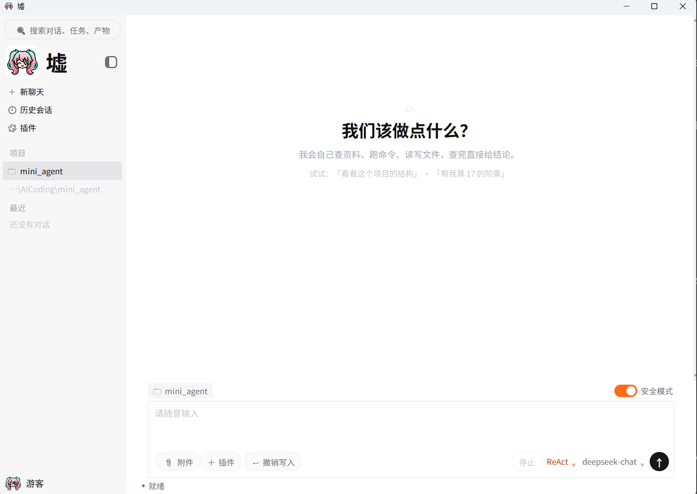

# 墟

一个能自己动手的通用智能体：**给它方向，不用给它脚本**。卡住会告诉你卡在哪、试过什么，做完会用工具结果自证一遍再交付。

**它解决什么**：现成的 Agent 框架通常背着几十个依赖、改坏文件没法撤回、模型跑飞了没有刹车、交付质量全靠模型自觉。墟把这四件事分别做成了硬机制——零依赖（只用 Python 标准库）、写前快照（可链式撤销）、六类熔断（到点收手）、验证式自检（拿工具结果证明任务真完成），而不是靠提示词请求模型「请小心」。

实现在 [`miniagent/`](miniagent)，Python 源码 13,768 行 + 界面 4,361 行，只用标准库，不需要 `pip install`。
有**图形界面**（tkinter 桌面窗口）和 CLI 两种用法，共用一个内核。

<p align="center">
  
</p>

<p align="center">
  <a href="https://github.com/Luo050129/--Agent/actions/workflows/ci.yml"></a>
  
  
  <a href="LICENSE"></a>
</p>

<p align="center"><sub>↑ 图形界面：左侧会话与项目、中间对话、底部输入卡片（安全模式开关 / 模型切换）</sub></p>

## 📑 目录

- [功能特性](#-功能特性)
- [快速开始](#-快速开始)
- [安装说明](#-安装说明)
- [配置说明](#-配置说明)
- [使用示例](#-使用示例)
- [项目结构](#-项目结构)
- [技术栈](#-技术栈)
- [贡献指南](#-贡献指南)
- [许可证](#-许可证)
- [常见问题](#-常见问题)

---

## ✨ 功能特性

- **零第三方依赖**：只用标准库。没有 `pip install` 这一步，也没有供应链风险。文档解析（docx/xlsx/pdf）自己写，MCP 协议自己实现。
- **图形界面 + 命令行双出口**：GUI 有会话列表、搜索、设置、MCP 面板；CLI 适合脚本和远程。两者共用同一个 `Sink` 事件接口，加界面不动内核。
- **验证式自检**：交付前必须给一个能证明完成的工具调用（读回刚写的文件、跑一遍刚改的代码）。验证失败自动返工一次，还不行就如实报「卡在哪」。纯问答走 `NOVERIFY` 放行，不折腾。
- **六类熔断**：同一调用重复、单调用反复失败、连续失败、原地打转、工具预算、时间预算。撞线立刻收手并给原因，不会无上限转圈。外加每分钟调用限流。
- **写前快照与撤销**：每次写入前存一份旧内容（环形 20 份），`/undo` 可连续回退。**边界：只快照文本文件，二进制不走这条路。**
- **三层进程约束**：解释器层限制 + 杀进程树 + 子进程守卫（拦 `subprocess`、`socket`、越界读写）。**边界：这是 patch 层拦截，不是虚拟机级隔离，挡不住刻意绕过。要跑不受信代码请用容器。**
- **48 个模型 / 4 种原生协议**：OpenAI 兼容、Anthropic Messages、Gemini、OpenAI Responses。加供应商只是往注册表加一行。
- **上下文预算管理**：超预算先折叠工具结果、再压缩旧消息，系统提示永不被挤掉。
- **可恢复会话**：每轮落盘，`--resume` 接着聊；崩溃截断的尾巴会自动修好。跑飞的会话恢复时提示「第 N 步中断」。
- **安全模式**：`--safe` 下写文件、跑命令、执行代码前先问一句；非交互环境默认拒绝，脚本里要放行显式加 `--yes`。
- **MCP / 技能 / 插件**：MCP 走标准协议接外部工具；技能是 `skills/*.md`（按需加载的方法论，无代码执行风险），插件是 Python 模块（加工具，有风险，确认话术不同）。
- **合规落地**：`manifest.json` 声明 SLA 且熔断上限从它读；参数运行时校验；TraceID 全链路；落盘前脱敏；提示词外置带版本、sha256 与灰度。

## 🚀 快速开始

```bash
git clone https://github.com/Luo050129/--Agent.git xu && cd xu

# 1. 不需要 Key：110 项功能自测（真工具、真子进程、真文件）
python -m miniagent.offline

# 2. 配 Key
cp .env.example .env      # 填入 DEEPSEEK_API_KEY

# 3. 跑起来
python gui.py                                       # 图形界面（解释器要带 tkinter，见下方说明）
python agent.py                                     # 交互模式
python agent.py "统计这个仓库有多少行 Python"          # 一次性任务
```

Windows 用户可以直接双击 `启动GUI.vbs`。

## 📦 安装说明

| 组件 | 要求 | 说明 |
| --- | --- | --- |
| Python | **3.11+** | 用到 `X \| None` 类型语法；3.10 及以下跑不了 |
| 第三方包 | **无** | `requirements.txt` 不存在，也不需要 |
| tkinter | 可选 | 只有图形界面需要。Windows 官方安装包自带；Linux 需 `apt install python3-tk`；macOS 自带 |
| API Key | 必需 | DeepSeek / OpenAI / Claude / Gemini 等任选，见[配置说明](#-配置说明) |

```bash
python --version                                   # 需要 3.11+
python -c "import tkinter; print('tkinter ok')"     # 只用命令行可跳过
```

## 🔧 配置说明

最小配置只有一个 Key（写进 `.env`，该文件已被 `.gitignore`）：

```bash
DEEPSEEK_API_KEY=sk-xxxx
```

其余可选，全部走环境变量：

| 变量 | 默认 | 作用 |
| --- | --- | --- |
| `AGENT_MODEL` | `deepseek-v4-flash` | 默认模型，可填注册表里的显示名或模型 id |
| `AGENT_BASE_URL` | 按模型推断 | 自定义 OpenAI 兼容地址 |
| `AGENT_MAX_STEPS` | `20` | 单轮最大工具步数 |
| `AGENT_CONTEXT_TOKENS` | `32000` | 上下文预算 |
| `AGENT_MAX_SAME_CALL` | `3` | 同一工具 + 同一参数最多重复几次 |
| `AGENT_MAX_CALLS_PER_MINUTE` | `30` | 每分钟工具调用上限（限流） |
| `AGENT_DEGRADE` | `normal` | 验证不通过怎么办：`strict` 收手 / `normal` 返工一次 / `lenient` 标注后交付 |
| `AGENT_PROMPT_VERSION` | `py-v1` | 强制指定提示词版本 |
| `AGENT_PROMPT_CANARY` | 空 | 灰度版本名；配合 `AGENT_PROMPT_CANARY_PCT`（默认 20）按会话稳定分桶 |
| `AGENT_READ_ROOTS` / `AGENT_WRITE_ROOTS` | 项目目录 | 沙箱允许读写的范围（分号分隔） |
| `AGENT_SANDBOX` | `1` | 设 `0` 关掉子进程守卫（只建议在容器里关） |

熔断的默认上限不是写死在代码里，而是从 `manifest.json` 的 `sla` 段读 —— **声明与实现同源**，免得文档写 300 秒、代码跑 600 秒。

## 💡 使用示例

**图形界面**

```bash
python gui.py
```

左侧：会话列表、搜索、设置、MCP 面板；底部：安全模式开关、模型切换、工作目录。不记命令也能用。

> 报 `No module named 'tkinter'` 说明这个解释器没编 tkinter（某些精简发行版和工具自带解释器会这样）。
> 换一个带 tkinter 的解释器即可，例如 `C:\Python314\python.exe gui.py`；Windows 上直接双击
> `启动GUI.vbs` 会自动挑一个能用的。

**交互模式**

```bash
python agent.py
```

| 命令 | 作用 |
| --- | --- |
| `/undo` | 撤销最近一次写入（可连续撤销，链式回退） |
| `/find 关键词` | 跨会话搜历史（多词要求全部命中） |
| `/sessions` | 列出存档，配合 `--resume <id>` 打开 |
| `/skill <路径或 GitHub 地址>` | 装一个技能 |
| `/clear` | 开新会话（旧的留在存档里） |
| `/exit` | 退出 |

**一次性任务**

```bash
python agent.py "把 docs/ 下所有 md 的标题列出来，按文件名排序"
```

**先规划再执行**

```bash
python agent.py --mode plan "重构 tools/ 目录，把网络请求抽成单独模块"
```

**安全模式（危险操作前确认）**

```bash
python agent.py --safe            # 写文件、跑命令前问一句
python agent.py --safe --yes      # 明确放行（脚本 / 自动化用）
```

**恢复上次会话**

```bash
python agent.py --resume          # 最近一次
python agent.py --resume 20261116-161212-zw29
```

**离线自测（不需要 Key、不需要模型）**

```bash
python -m miniagent.offline           # 全量 110 项
python -m miniagent.offline 沙箱       # 只跑名字含「沙箱」的组
python -m miniagent.offline 规范       # 合规验收组
```

它和 `tests/` 的分工：单测用替身验证「逻辑分支对不对」，自测用真工具、真子进程、真文件验证「功能能不能用」。新环境第一件事应该是跑自测。

**换模型**

```bash
python agent.py -m "Claude Sonnet 4.5" "..."
python agent.py -m "Gemini 2.5 Pro" "..."
python agent.py --base-url https://my-endpoint/v1 -m my-model "..."
```

## 📁 项目结构

```
miniagent/            主实现（Python 0.2.0，零第三方依赖）
├── core/             内核
│   ├── loop.py           ReAct + Plan 双模式、验证自检、降级分流
│   ├── guard.py          六类熔断 + 限流 + 停止码
│   ├── context.py        预算压缩、工具结果折叠、运行记录
│   ├── session.py        单口写入 + 插话队列 + 状态观察者
│   ├── persistence.py    会话存档、恢复、中断标记
│   ├── prompt.py         提示词装配、版本与灰度分桶
│   ├── search.py         会话内检索 + 跨会话检索
│   └── redact.py         落盘前脱敏
├── tools/            工具：文件、命令、沙箱、文档解析、网络
│   ├── sandbox.py        三层进程约束
│   └── validate.py       参数运行时校验
├── model/            模型层：客户端、注册表、4 种协议适配
├── mcp/              MCP 客户端与管理器（自己实现的协议）
├── skills/           技能发现与安装
├── plugins/          插件加载
├── ui/               图形界面：窗口、对话框、搜索、设置、主题、控件
└── offline.py        离线自测器（110 项，不调模型）

agent.py            CLI 入口
gui.py              GUI 入口
rules.md            运行时规则（每轮注入系统提示词，所以要精简）
agent.md            开发约定（同样注入，写给它自己看的）
manifest.json       元数据与 SLA（熔断上限的来源）

prompts/            提示词模板 + 版本索引（带 sha256）+ CHANGELOG
skills/             示例技能（*.md）
examples/           插件示例
assets/             程序用图：头像、侧栏品牌图、窗口图标
docs/               设计文档与规范
├── images/           文档配图
├── system-analysis.md      系统分析（边界、反馈回路、已知缺口）
├── agent-blueprint.md      架构蓝图与阈值依据
├── agent-spec-compliance.md 七大开发规范合规评审
├── providers.md            供应商与协议说明
└── doc-style-guide.md      文档写作与格式规范
tests/              25 个测试套件
```

## 🧱 技术栈

| 层 | 选择 | 为什么 |
| --- | --- | --- |
| 语言 | Python 3.11+ | 标准库够用；类型语法够表达 |
| 界面 | tkinter | 标准库自带，不引 Qt / Electron |
| 网络 | `urllib` + 自写 SSE 解析 | 不引 requests / httpx |
| 文档 | 自写 docx / xlsx / pdf 解析 | 不引 python-docx / openpyxl / pypdf |
| 存储 | JSONL 追加写 | 崩溃只截断尾巴，可修复；不需要数据库 |
| 模型协议 | 4 种原生适配 | 加供应商只加一行注册表 |
| 测试 | 自写断言 + 自研自测器 | 不引 pytest |

**为什么不用 LangChain / AutoGen？** 它们抽象掉的正是这个项目要展示的部分：循环控制、熔断、上下文管理、验证。而且它们带一堆依赖，与「零依赖」直接冲突。

## 🤝 贡献指南

```bash
# 提交前必须全绿
python -m miniagent.offline                                        # 110 项功能自测
for f in tests/test_*.py; do python "$f" || echo "FAIL $f"; done    # 25 个套件
```

代码约定：

- **工具永不抛异常**：失败转 `[ERR] ...` 文本回灌给模型，让它换做法
- **历史单口写入**：一切走 `Session.append()`，持久化 / 记录 / 计数都挂它
- **落盘前脱敏**：记录与会话档写盘前过 `redact()`
- **熔断上限从 `manifest.json` 读**，不要在代码里另写一份数字
- 改提示词必须同时更新 `prompts/index.json` 的 `sha256` 与 `CHANGELOG.md`（自测会查）
- 新增能力必须配自测项 —— 没被自测覆盖的功能，下次改坏了没人知道

**分层约束**见 [`agent.md`](agent.md)：`ui → core → tools → 扩展 → config`，`model` 独立，`markers.py` / `tokens.py` 是叶子。

**改文档**：照[文档写作与格式规范](docs/doc-style-guide.md)——表格只用于对照、路径加反引号、数字必须对得上测试输出、每个能力写一句边界。

CI 在 Linux 上跑一轮（offline 自测 + 25 个套件，GUI 用 xvfb）；失败时会把完整日志推到 `ci-logs` 分支，方便离线排查。

## 📄 许可证

MIT，见 [LICENSE](LICENSE)。

从 GitHub 装进来的第三方技能与插件不在本协议覆盖范围内，以原作者协议为准；插件是第三方代码，装进来等于允许它在你的机器上运行，请自行评估。

## ❓ 常见问题

**Q：跑起来报「没找到 API Key」怎么办？**
按提示三选一：环境变量 `DEEPSEEK_API_KEY`、项目根的 `.env`、或 `--api-key` 参数。这是刻意的——缺 Key 时直接停下并给出三种办法，而不是带一个假 Key 去请求、让你对着 `401` 猜。

**Q：没有 API Key 能用吗？**
能跑自测、读代码，但不能对话。`python -m miniagent.offline` 不需要 Key，覆盖 110 项功能。

**Q：报「找不到 tkinter」怎么办？**
只有图形界面需要它。Linux：`sudo apt install python3-tk`；Windows / macOS 用官方安装包自带。只用命令行就跳过。

**Q：为什么我让它读文件，它说越界拒绝？**
沙箱只允许读写项目目录。要操作别的路径先设 `AGENT_READ_ROOTS` / `AGENT_WRITE_ROOTS`（多个用 `;` 分隔），或把文件放进项目里。

**Q：它反复调同一个工具，是不是坏了？**
那是熔断在等触发。同一工具 + 同一参数第 3 次会被拦，然后它会换个做法或如实报卡点。想放宽：`AGENT_MAX_SAME_CALL=5`。

**Q：提示「上下文 92%」会怎样？**
超预算先折叠工具结果（只留摘要），再压缩旧对话，系统提示和最近若干轮不动。长任务建议拆小，或把中间结论落到文件里让它读。

**Q：验证式自检会不会拖慢速度？**
只在「模型说做完了」那一刻触发一次探针（多一次模型调用 + 一到三个工具执行）。纯问答会被判为 `NOVERIFY` 直接放行。嫌吵可以设 `AGENT_DEGRADE=lenient`：不返工，只在结果后标注「未核实」。

**Q：Windows 终端中文乱码？**
用 Windows Terminal，或先 `chcp 65001`。图形界面不受影响。

**Q：怎么换成 Claude 或 Gemini？**
`python agent.py -m "Claude Sonnet 4.5" "..."`，Key 分别读 `ANTHROPIC_API_KEY` / `GEMINI_API_KEY`。四种原生协议已经实现好了。

**Q：还有 TypeScript 版吗？**
有过，但已撤出版本库，只保留在本地工作副本里（不随仓库分发）。原因很实际：两版并行维护会分叉，
而 Python 版在供应商覆盖（48 vs 11）、协议（4 vs 3）和界面完整度上都更强。
现在的唯一实现是 `miniagent/`（0.2.0）。

**Q：它的沙箱能防住恶意代码吗？**
**不能。** 它是 patch 层拦截（拦 `subprocess`、`socket`、越界读写），不是内核级隔离，刻意绕过能突破。要跑真正不受信的代码请用容器或虚拟机。

**Q：数据存在哪？会不会上传？**
全在本机：会话与记录在 `.agent/sessions`、`.agent/records`，检查点在 `.agent/checkpoints`，都被 `.gitignore` 排除。除你配置的模型接口和主动调用的 MCP 服务器，不会发往别处；记录落盘前会脱敏（`sk-`、`Bearer`、`token=`、本机用户名路径、邮箱）。
